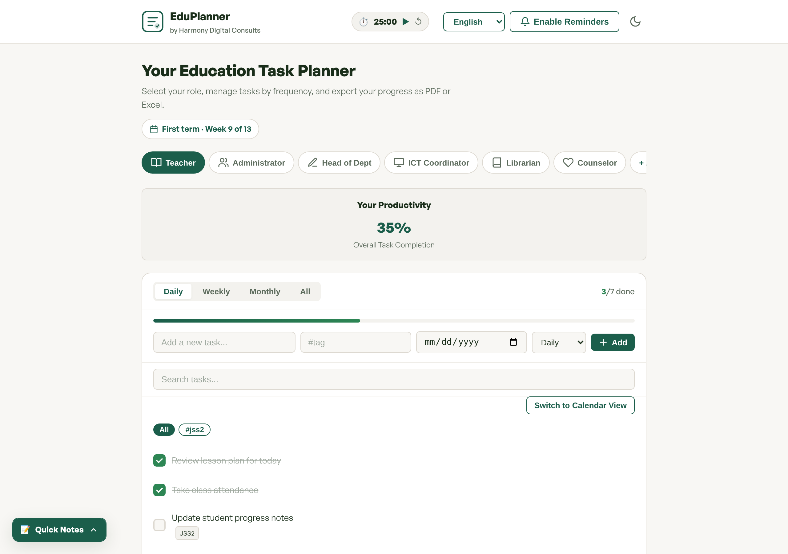
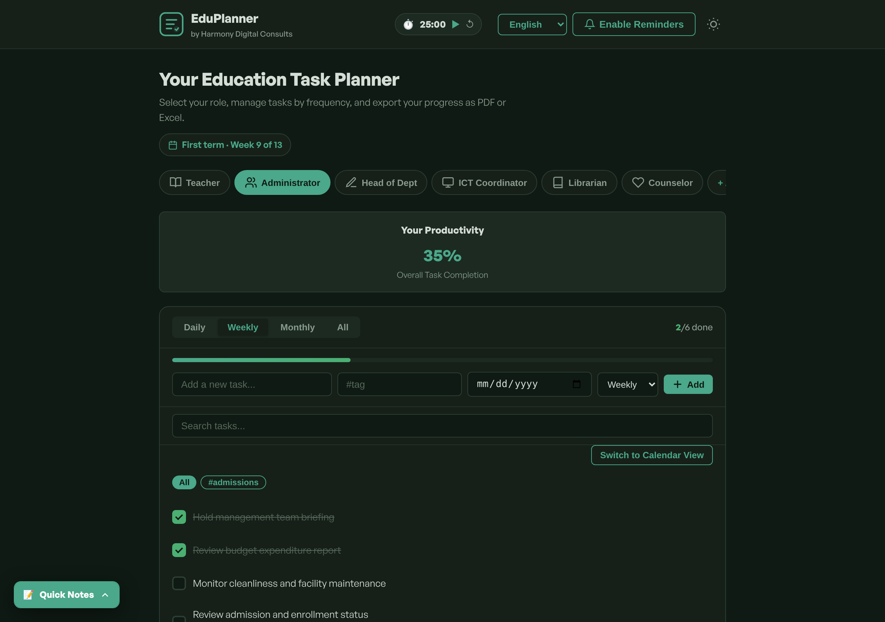
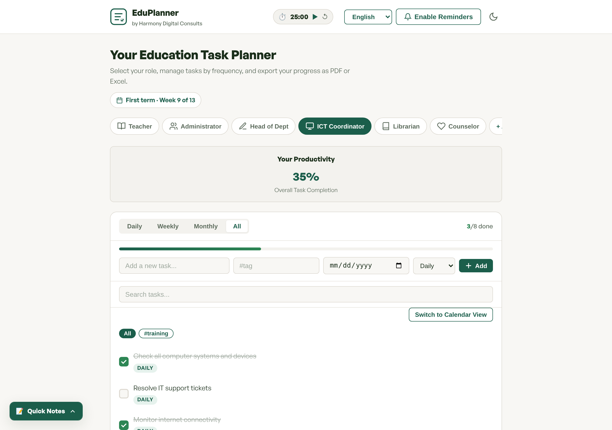
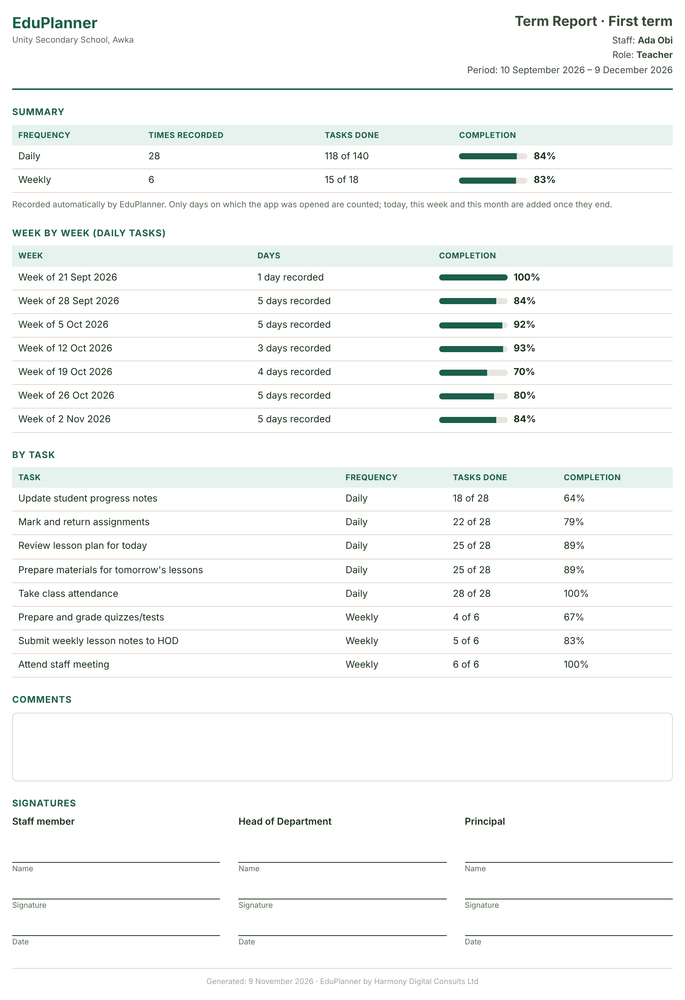
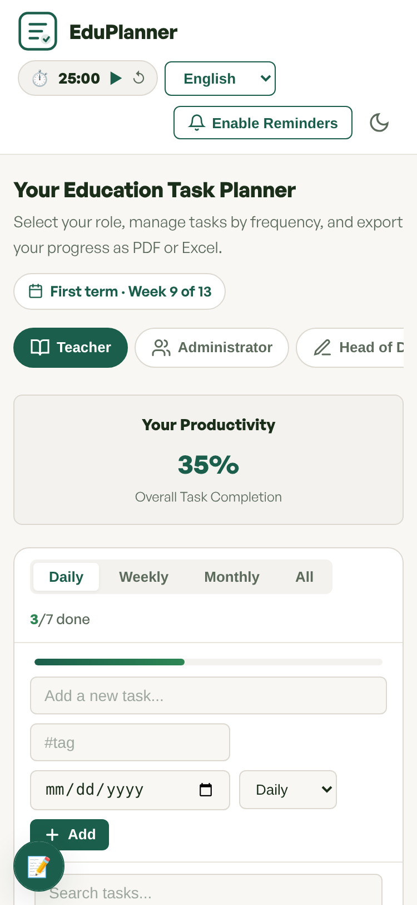
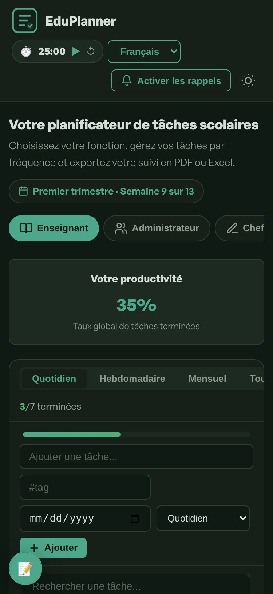

<div align="center">


# EduPlanner

**A free, role-based task planner for educators.**

Built by [Harmony Digital Consults Ltd](https://harmonyconsults.com) — Anambra State, Nigeria.

[](https://eduplanner.harmonydigitalconsults.com.ng)
[](https://chukwuemerie-ezieke.github.io/eduplanner/)
[](LICENSE)

</div>

---

## The Problem

Nigerian school staff juggle dozens of recurring tasks — lesson plans, attendance, reports, meetings, IT maintenance, student welfare — often tracked on paper or scattered across personal notes. Generic productivity tools require sign-ups, training, and reliable internet that many schools lack.

## The Solution

EduPlanner gives every school role a ready-to-use task module with pre-populated daily, weekly, and monthly tasks. No signup. No internet after first visit. Export to PDF or Excel for physical record-keeping.

---

## Screenshots

### Light Mode — Teacher Daily Tasks


### Dark Mode — Administrator Weekly Tasks


### All Tasks View — ICT Coordinator


### Term Report — printable, with signature lines


<details>
<summary><strong>📱 Mobile Views (light, and dark in French)</strong></summary>

<div align="center">
&nbsp;&nbsp;&nbsp;

</div>

</details>

---

## Features

| Feature | Description |
|---------|-------------|
| **6 Dedicated Roles** | Teacher, Administrator, Head of Department, ICT Coordinator, Librarian, School Counselor |
| **Pre-populated Tasks** | Each role ships with common daily, weekly, and monthly tasks — ready to use instantly |
| **Custom Tasks** | Add your own tasks to any frequency category, and edit any task's text, frequency, due date or tag |
| **PDF Export** | Generate branded, printable task reports |
| **Excel Export** | Download task data as `.xlsx` spreadsheets |
| **Term Report** | Printable record of completed tasks over any date range: summary, week-by-week progress, per-task completion, comments box and signature lines for staff, HOD and principal |
| **School Terms** | Set the three term dates and mid-term breaks once: the app shows the current term and week, pauses progress tracking during holidays, and the term report picks the term automatically |
| **Works Offline (PWA)** | Install on any phone or computer — full functionality without internet |
| **Dark Mode** | Auto-detects system preference with manual toggle |
| **3 Languages** | English, French and Nigerian Pidgin, including all built-in tasks, exports and messages. French browsers start in French |
| **No Signup Required** | Zero accounts, zero cost, no personal data collected (see [Privacy](#privacy-preserving-analytics)) |
| **localStorage** | Data persists across sessions on the same device |
| **Backups & Recovery** | One-file backups (tasks, custom roles, notes), backup reminders, and a 30-day "Recently deleted" bin |
| **Open Source** | MIT License — customize and redistribute freely |

---

## Tech Stack

| Component | Technology |
|-----------|------------|
| Frontend | Vanilla HTML, CSS, JavaScript |
| Storage | Browser localStorage |
| Backend | None (zero hosting cost) |
| Excel Export | [SheetJS](https://sheetjs.com/) |
| Offline | Service Worker + Web App Manifest |
| Typography | [General Sans](https://www.fontshare.com/fonts/general-sans) via Fontshare |
| Design | Forest Green `#1B5E4B` + Warm Gold `#C4960A` |

---

## Getting Started

### Use Online (Recommended)

Visit **[eduplanner.harmonydigitalconsults.com.ng](https://eduplanner.harmonydigitalconsults.com.ng)** in any browser. That's it.

To install as an app, click the **Install** button in the header (or use your browser's "Add to Home Screen" option on mobile).

### Self-Host

EduPlanner is a static site — no build step, no dependencies, no server required.

```bash
# Clone the repository
git clone https://github.com/Chukwuemerie-ezieke/eduplanner.git
cd eduplanner

# Option 1: Python
python3 -m http.server 8000

# Option 2: Node.js
npx serve .

# Option 3: PHP
php -S localhost:8000

# Then open http://localhost:8000
```

Or simply open `index.html` directly in your browser.

### Deploy to GitHub Pages

1. Fork this repository
2. Go to **Settings → Pages**
3. Set source to `master` branch, root folder
4. Your app will be live at `https://yourusername.github.io/eduplanner`

### Deploy to Netlify / Vercel

Drag and drop the project folder — no configuration needed.

---

## Project Structure

```
eduplanner/
├── index.html          # Main HTML structure
├── style.css           # All styles (light + dark mode)
├── app.js              # App logic, task management, exports
├── i18n.js             # Translations (English, French, Nigerian Pidgin)
├── default-tasks.js    # Built-in tasks for each role (English)
├── dialog.js           # In-app dialog (replaces browser pop-ups)
├── report.js           # Printable term report layout
├── sw.js               # Service worker for offline support
├── CHANGELOG.md        # What changed in each release
├── analytics.js        # Optional, privacy-filtered analytics
├── config.js           # Analytics settings
├── manifest.json       # PWA manifest
├── package.json        # Dev-only: smoke test runner
├── tests/
│   ├── smoke.test.js   # Browser smoke tests (Playwright)
│   └── screenshots.js  # Regenerates the README screenshots
├── LICENSE             # MIT License
├── CNAME               # Custom domain config
├── icons/
│   ├── favicon.svg     # SVG favicon
│   ├── icon-192.png    # PWA icon 192x192
│   └── icon-512.png    # PWA icon 512x512
└── screenshots/
    ├── hero-light.png
    ├── dark-mode.png
    ├── all-tasks.png
    ├── mobile.png
    └── mobile-dark.png
```

### Running the smoke tests

The app itself has no build step. The tests only need Node.js and Playwright:

```bash
npm install
npx playwright install chromium
npm test
```

They load the app in Chromium and check that tasks render, tasks and subtasks can be added, shared links and backups are validated, custom roles work, and the app runs offline. GitHub Actions runs them on every pull request.

**Releasing:** bump `APP_VERSION` in both `app.js` and `sw.js` (a test fails if they differ), and add an entry to `CHANGELOG.md`. The new version clears installed copies' old cache. To refresh the README screenshots, run `npm run screenshots`.

---

## Languages

All interface text lives in `i18n.js`:

- `ui.en`, `ui.fr`, `ui.pidgin`: every button, message and label. `{name}` placeholders are filled in by the app.
- `tasks`: translations of the built-in tasks, keyed by their English text. Built-in tasks are stored in English and translated when shown, so tasks people type themselves are never changed.

**To add a language:** copy the `en` block in `ui` to a new key (e.g. `ha`), translate it, add that language to each entry in `tasks`, and add a `locales` entry and an `<option>` in the language picker in `index.html`. The smoke tests show any English left on screen.

---

## Roles & Pre-loaded Tasks

Each role comes with curated tasks across three frequencies:

### 👩‍🏫 Teacher
Daily: lesson plans, attendance, grading, classroom prep
Weekly: lesson note submission, quizzes, scheme of work review
Monthly: progress reports, parent communication, performance analysis

### 👔 Administrator
Daily: correspondence, staff monitoring, discipline, operations
Weekly: management briefings, budget review, maintenance checks
Monthly: financial summaries, staff reviews, compliance documents

### 📝 Head of Department
Daily: teaching quality monitoring, classroom visits
Weekly: departmental meetings, lesson note reviews, mentoring
Monthly: performance reports, curriculum review, training sessions

### 💻 ICT Coordinator
Daily: device checks, IT support, connectivity, backups
Weekly: system updates, staff training, inventory audits
Monthly: infrastructure reports, procurement, cybersecurity awareness

### 📚 Librarian
Daily: library operations, checkouts/returns, student support
Weekly: catalog updates, reading promotion, overdue tracking
Monthly: usage statistics, book recommendations, library events

### 💚 School Counselor
Daily: referral reviews, counseling sessions, follow-ups
Weekly: group sessions, parent meetings, classroom guidance
Monthly: activity reports, wellness workshops, career guidance

---

## How It Works

1. **Select your role** from the tabs at the top
2. **Switch frequency** — Daily, Weekly, Monthly, or All
3. **Check off tasks** as you complete them
4. **Add custom tasks** using the input field, or tap the pencil on any task to edit it
5. **Export** your task list as PDF or Excel when needed, or create a **Term report** for supervision and appraisals
6. **Clear completed** tasks to keep your list clean. Deleted or cleared tasks can be restored from **Recently deleted** for 30 days

Data is saved automatically in your browser. It persists across sessions but stays entirely on your device, so **clearing browser data or switching devices loses it unless you have a backup**:

- **Backup (JSON)** downloads one file with your tasks, custom roles and quick notes. **Restore** loads it on any device.
- If you've made changes and haven't backed up in 14 days, EduPlanner shows a reminder.
- EduPlanner asks the browser to keep its storage so it isn't cleared automatically.
- If storage is full or saved data can't be read, you'll see a warning instead of losing data silently.

---

## Contributing

Contributions are welcome. Here's how:

1. Fork the repository
2. Create a feature branch (`git checkout -b feature/amazing-feature`)
3. Commit your changes (`git commit -m 'Add amazing feature'`)
4. Push to the branch (`git push origin feature/amazing-feature`)
5. Open a Pull Request

### Ideas for Contributions

- [ ] Drag-and-drop task reordering
- [ ] Task due dates and reminders
- [ ] Data import/export (JSON backup)
- [ ] Localization (Yoruba, Hausa, Igbo, French)
- [ ] Print-optimized view
- [ ] Custom role creation
- [ ] Task templates marketplace

---

## License

This project is licensed under the **MIT License** — see the [LICENSE](LICENSE) file for details.

You are free to use, modify, and distribute this software for any purpose, including commercial use.

---

<div align="center">

**Built with care by [Harmony Digital Consults Ltd](https://harmonyconsults.com)**

Empowering Nigerian schools with free, practical technology tools.

Anambra State, Nigeria

---

*No account needed · Data stays on your device · Works offline · 100% free*

</div>

---

## Privacy-preserving Analytics

EduPlanner supports optional, privacy-focused analytics to help developers understand usage while respecting users.

**Analytics is opt-in.** On the hosted site (eduplanner.harmonydigitalconsults.com.ng), nothing is loaded or sent until you click **Allow** on the usage-stats banner. You can change your choice any time with the **Usage stats** switch in the footer. If your browser has "Do Not Track" or Global Privacy Control turned on, the banner never appears and nothing is sent.

**Self-hosting:** analytics are controlled by `config.js`:
1. Copy `config.example.js` to `config.js`.
2. Set `ANALYTICS_ENABLED: true` to offer the opt-in banner (or `false` to remove analytics entirely).
3. Add your **Cloudflare Web Analytics** token and/or **PostHog** Project API Key.

**What we track:**
- Page views (e.g., viewing Home).
- Basic application events (e.g., \`task_create\`, \`task_complete\`, \`export_data\`).
- UI interactions (e.g., theme toggle, role switching).

**What we NEVER track (Strict Privacy Promise):**
- Personal identifiers (Names, emails, IDs).
- The text content of your tasks or notes.
- User profiles (PostHog events are anonymous; no person profiles are created).
- Cross-site tracking cookies.

**Offline Support:**
For users who opted in, EduPlanner queues analytics events when offline and securely flushes them once reconnected. No data is lost when used as an offline PWA.

To disable analytics completely, either do not provide a `config.js` file, set `ANALYTICS_ENABLED: false`, or use your browser's "Do Not Track" / Global Privacy Control features.
